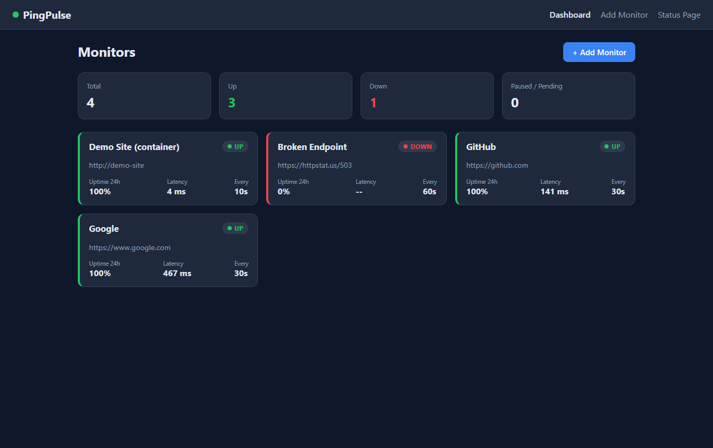
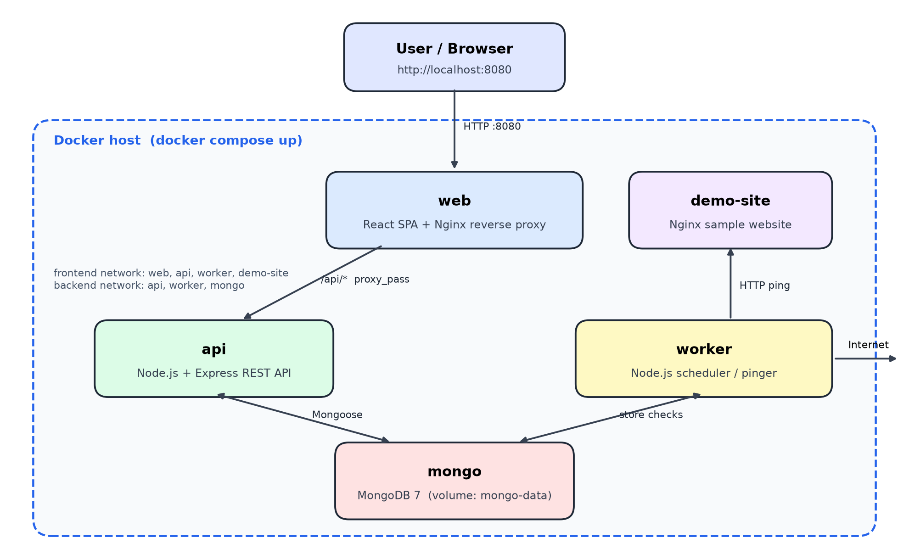
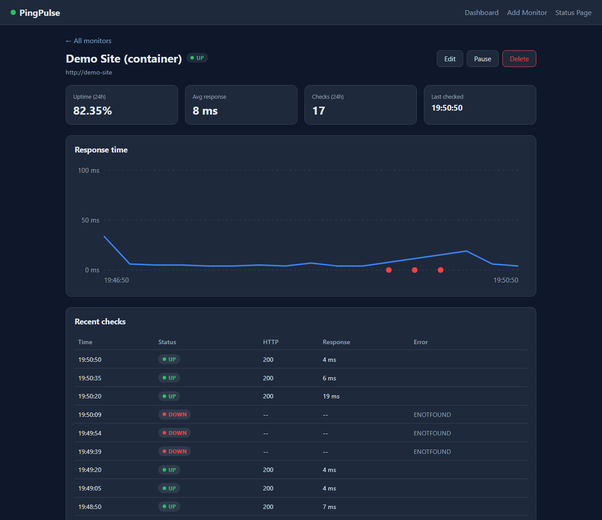
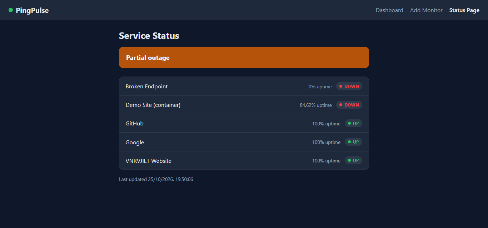

# PingPulse – Self-Hosted Uptime Monitor

PingPulse is a containerized microservices application that monitors websites and services,
records their availability and response time, and shows live status on a dashboard and a public
status page. It is built with **Node.js, Express, React, MongoDB, Nginx, Docker Compose** and
uses **GitHub Actions** for continuous integration.



## Architecture



```
            Browser
               │  :8080
        ┌──────▼──────┐
        │  web (Nginx)│  React SPA + reverse proxy for /api
        └──────┬──────┘
               │ /api/*            frontend network
        ┌──────▼──────┐        ┌──────────────┐
        │ api (Express)│        │ worker (Node)│──► pings monitored URLs
        └──────┬──────┘        └──────┬───────┘     (internet + demo-site)
               │     backend network  │
               └────────┬─────────────┘
                 ┌──────▼──────┐
                 │   MongoDB   │  named volume: mongo-data
                 └─────────────┘
```

| Service     | Tech                    | Responsibility                                          |
|-------------|-------------------------|---------------------------------------------------------|
| `web`       | React (Vite) + Nginx    | Dashboard, monitor details, status page; proxies `/api` |
| `api`       | Node.js + Express       | REST API for monitors, checks and status summary        |
| `worker`    | Node.js                 | Pings every active monitor on its interval, stores results |
| `mongo`     | MongoDB 7               | Persists monitors and checks (checks auto-expire after 7 days) |
| `demo-site` | Nginx                   | Sample website used to demonstrate outage detection     |

## Quick start

```bash
docker compose up -d --build
```

Open <http://localhost:8080>. Four demo monitors are created on first start.

**Outage demo**

```bash
docker compose stop demo-site     # dashboard turns red within ~10 s
docker compose logs -f worker     # see the [ALERT] line
docker compose start demo-site    # monitor recovers
```

| Monitor detail | Status page |
|---|---|
|  |  |

## REST API

| Method | Endpoint                     | Description                      |
|--------|------------------------------|----------------------------------|
| GET    | `/api/health`                | Health check (used by Docker)    |
| GET    | `/api/monitors`              | List monitors with 24h stats     |
| POST   | `/api/monitors`              | Create monitor `{name, url, intervalSec}` |
| GET    | `/api/monitors/:id`          | Single monitor with stats        |
| PUT    | `/api/monitors/:id`          | Update monitor                   |
| PATCH  | `/api/monitors/:id/toggle`   | Pause / resume                   |
| DELETE | `/api/monitors/:id`          | Delete monitor and its checks    |
| GET    | `/api/monitors/:id/checks`   | Recent checks (`?limit=50`)      |
| GET    | `/api/status`                | Public status summary            |

## Local development (without Docker)

```bash
cd server && npm install && npm run dev     # needs MongoDB on localhost:27017
cd worker && npm install && npm start
cd client && npm install && npm run dev     # http://localhost:5173
```

Run unit tests with `npm test` inside `server/` and `worker/`.

## CI/CD

`.github/workflows/ci.yml` runs on every push and pull request:

1. Unit tests for `server` and `worker` (matrix job)
2. Production build of the React client
3. Builds all Docker images, starts the full stack with `docker compose up --wait`
   and smoke-tests the API through Nginx
